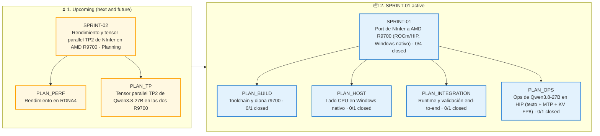

# Plans board — ninfer

Every substantial change is governed by a plan document before production code is touched. Work is organised in
sprints, managed by the `concertino` skills; the project's own facts are in [CONCERTINO.md](CONCERTINO.md).

## Convention

- **[current/](current/)**: active sprint (`SPRINT.md`, group plans, LAUNCH, USAGE, QUESTIONS, issues).
- **[next/](next/)**: the next sprint being prepared. Preparing it does not activate it.
- **[future/](future/README.md)**: later sprints, one per folder (`future/SPRINT-NN/SPRINT.md`).
  When next is activated, `future/SPRINT-(n+1)` is promoted to next.
- **[backlog/](backlog/README.md)**: future plans without a sprint.
- **[issues/](issues/index.md)**: live issues outside sprints ([template](issues/TEMPLATE_ISSUE.md)).
- **[usage/](usage/README.md)**: global quota and cost register ([protocol](USAGE_PROTOCOL.md)); never moved.
- **[archive/](archive/index.md)**: complete dossier of every closed sprint (`SPRINT-NN_<start>_<end>/`).
- **[DEPENDENCIES.md](DEPENDENCIES.md)**: dependencies of our sprints on sprints of other projects;
  `concertino deps` shows the graph and what is ready to start.
- **[GOVERNANCE.md](GOVERNANCE.md)**: who owns, writes and decides each thing.
- **[QUESTIONS.md](QUESTIONS.md)**: questions to the user outside sprints. **[INBOX.md](INBOX.md)**: messages to the director.
- **[harness/](harness/README.md)**: execution harness and boot steps of the director's handoffs.
- **[STATUS.md](STATUS.md)**: live global status.

Cycle: planning → start → execution → close and archive → freeze → release → planning.

## Status

| Phase | Sprint | Link |
|---|---|---|
| Active | SPRINT-01 — Port ROCm R9700 (desde 2026-11-16) | [current/SPRINT.md](current/SPRINT.md) |
| Next | SPRINT-02 — Rendimiento y TP2 en R9700 (planning) | [next/SPRINT.md](next/SPRINT.md) |
| Future | none | [future/](future/README.md) |
| Last closed | none | [archive/](archive/index.md) |

## Backlog

| Plan | Scope | Status | Description |
|---|---|---|---|

## 🧭 Plans Kanban board

Generated from `docs/plans`: backlog, upcoming sprints, active sprint with the progress of each plan, closed sprints and open issues.

<!-- kanban:start -->
<!-- Generated by `dashboard.py kanban --write` (skill concertino); do not edit by hand: it is regenerated. -->

Links of the plans and issues

**⏳ Upcoming (next and future)**

- [SPRINT-02](next/SPRINT.md) — Rendimiento y tensor parallel TP2 de NInfer en AMD R9700
  - [PLAN_PERF](next/PLAN_PERF.md) — Rendimiento en RDNA4
  - [PLAN_TP](next/PLAN_TP.md) — Tensor parallel TP2 de Qwen3.8-27B en las dos R9700

**📦 SPRINT-01 active**

- [SPRINT-01](current/SPRINT.md) — Port de NInfer a AMD R9700 (ROCm/HIP, Windows nativo)
  - [PLAN_BUILD](current/PLAN_BUILD.md) — Toolchain y diana r9700
  - [PLAN_HOST](current/PLAN_HOST.md) — Lado CPU en Windows nativo
  - [PLAN_INTEGRATION](current/PLAN_INTEGRATION.md) — Runtime y validación end-to-end
  - [PLAN_OPS](current/PLAN_OPS.md) — Ops de Qwen3.8-27B en HIP (texto + MTP + KV FP8)

<!-- kanban:end -->
